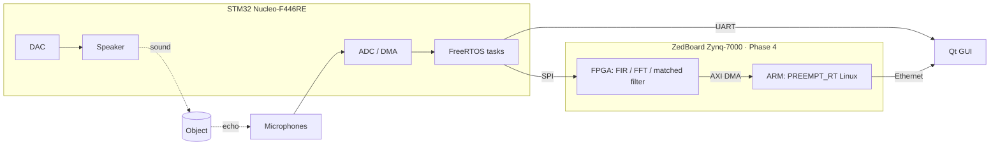

# airsonar

**Underwater acoustics in air — an active sonar and an acoustic modem built with STM32, Zynq FPGA and Qt.**

Underwater systems use sound for two things: **finding targets** (sonar) and **sending data** (acoustic modems).
airsonar reproduces both at small scale in air, using a speaker and microphones. The physics and the signal
processing are the same; only the speed of sound changes (343 m/s in air vs. ~1500 m/s in water), and room
echoes act as a stand-in for underwater multipath.

## Goals

1. **Active sonar** — measure the range, bearing and motion of an object using LFM chirps, matched filtering,
   CFAR detection, two-microphone bearing estimation and Doppler processing.
2. **Acoustic modem** — send data between two devices using only sound: FSK, BPSK/QPSK, synchronization,
   equalization and error-correcting codes.

## System architecture

## Hardware

| Part | Role |
|---|---|
| STM32 Nucleo-F446RE | Sensor node: sampling, DAC output, FreeRTOS |
| ZedBoard (Zynq XC7Z020) | Processing unit: FPGA DSP + embedded Linux |
| 2× MAX9814 microphone modules | Receivers |
| Speaker + PAM8403 amplifier | Transmitter |
| Logic analyzer (sigrok/PulseView) | Debugging and timing measurements |

Details: [`hardware/`](hardware/README.md)

## Repository layout

| Folder | Content |
|---|---|
| [`docs/reports/`](docs/reports) | Weekly engineering reports |
| [`docs/diagrams/`](docs/diagrams) | Architecture and signal-flow diagrams (Mermaid) |
| [`python/`](python) | Algorithm prototypes and notebooks |
| [`firmware/nucleo-f446re/airsonar-fw/`](firmware/nucleo-f446re/airsonar-fw) | STM32 firmware (C++17, AUTOSAR C++14 guidelines) |
| [`host/airsonar-gui/`](host/airsonar-gui) | Qt desktop application |
| [`fpga/zedboard/`](fpga/zedboard) | Verilog sources, testbenches, constraints, Vivado Tcl scripts |
| [`linux/`](linux) | Kernel driver and Linux configuration (Phase 4) |
| [`hardware/`](hardware) | Wiring diagrams and bill of materials |

## Progress

See [ROADMAP.md](ROADMAP.md) for the full plan.

| Milestone | Status | Demo |
|---|---|---|
| Week 00 — laptop sonar (Python) | 🟡 Simulation done, wall measurement pending | — |
| Week 01 — first C++ firmware: LED, UART, AUTOSAR C++14 setup | ✅ Done | — |
| `v0.1-live-spectrum` — real-time spectrum on Qt | ⏳ Planned | — |
| `v0.2-data-node` — SPI, I2C, FreeRTOS data acquisition node | ⏳ Planned | — |
| `v0.3-sonar-ranging` — chirp sonar with range, bearing, Doppler | ⏳ Planned | — |
| `v0.4-acoustic-modem` — data link over sound | ⏳ Planned | — |
| `v1.0-zynq-system` — FPGA DSP + RT Linux integration | ⏳ Planned | — |

## Development workflow

Every algorithm follows the same path: **theory → Python prototype → real-time C++ implementation → measurement**.
Code follows [CODING_STANDARD.md](CODING_STANDARD.md) ([Türkçe](CODING_STANDARD.tr.md)). Every rule applied in the firmware is recorded in the [compliance log](docs/coding-rules/compliance-log.md).

## License

[MIT](LICENSE)
