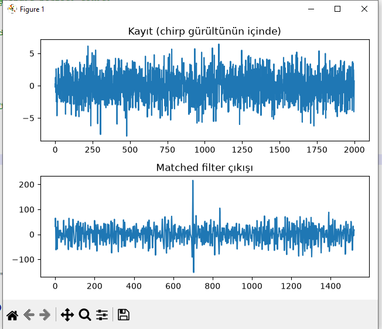
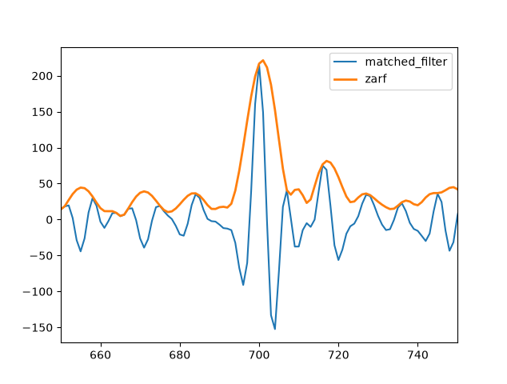
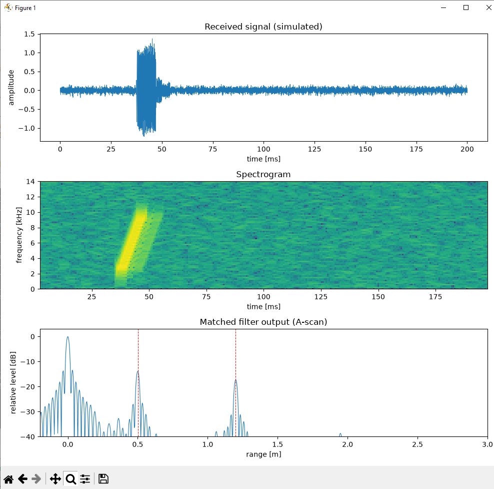
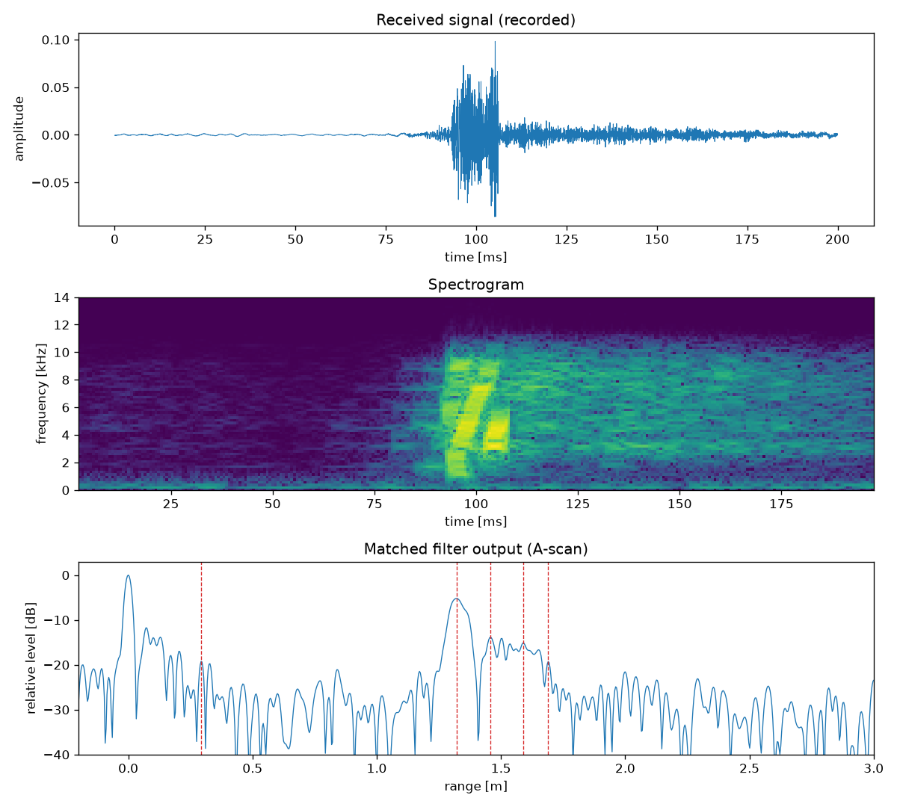
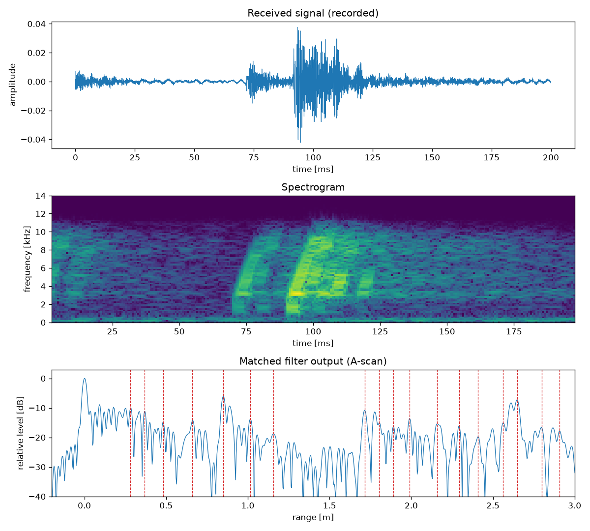
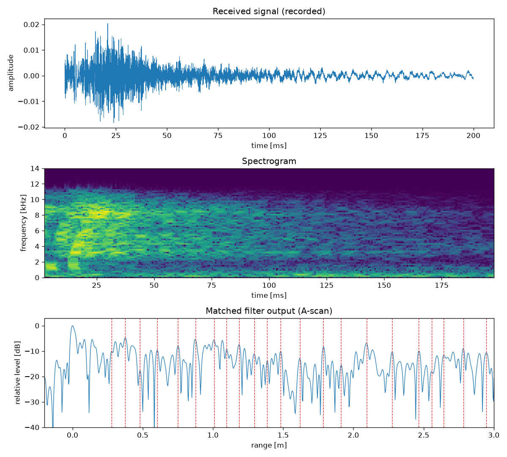
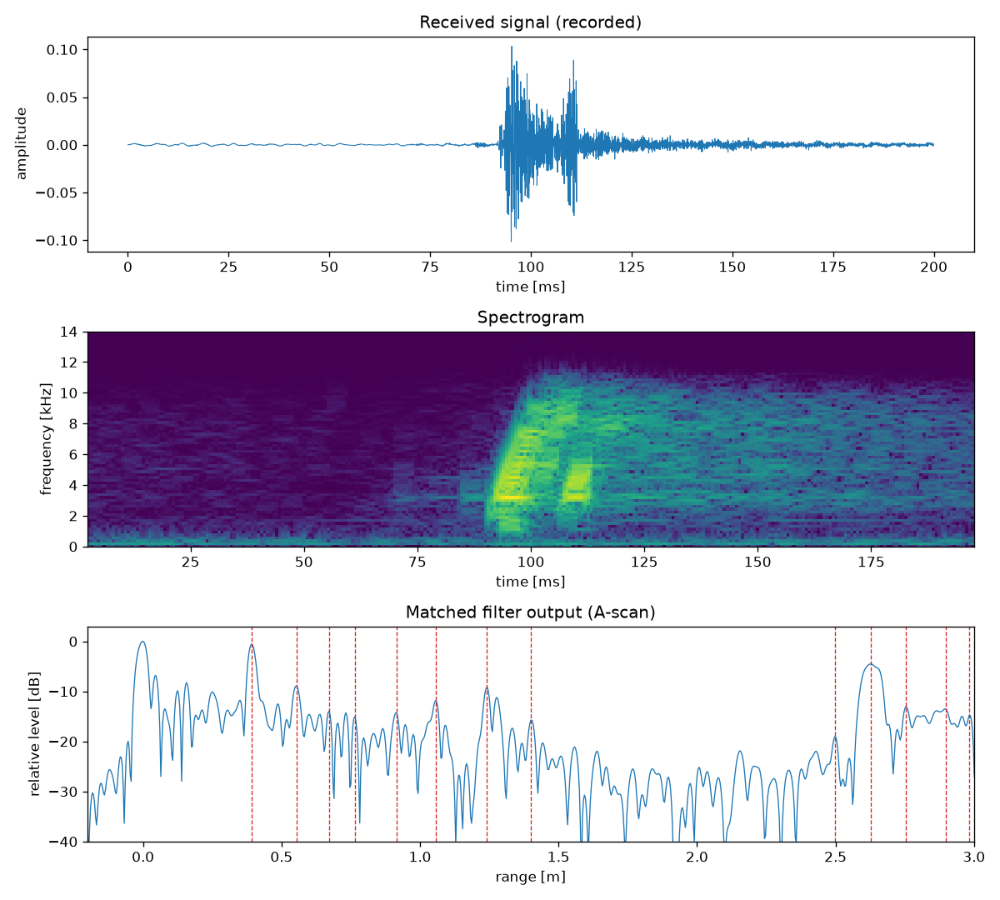

# Week 00 — Laptop sonar

**Phase:** 0 (warm-up) · **Date:** 2026-11-13 · **Status:** 🟡 In progress — real wall measurement pending
**Code:** [`python/experiments/00_laptop_sonar/`](../../../python/experiments/00_laptop_sonar)

## 1. Goal

Before touching any embedded hardware, prove that the core idea of the project works:
send an LFM chirp from a laptop speaker, record it with the laptop microphone, and measure the
distance to a wall with a matched filter.

## 2. Theory

### 2.1 LFM chirp

A linear frequency-modulated (LFM) chirp sweeps its frequency linearly over time:

f(t) = f0 + k·t, with k = (f1 − f0) / T

The phase is the **integral** of the frequency:

φ(t) = 2π · (f0·t + ½·k·t²),  s(t) = sin(φ(t))

> **Pitfall:** writing `sin(2π·(f0 + k·t)·t)` looks natural but is wrong. Its instantaneous frequency is
> f0 + 2·k·t, so our chirp would end at 18 kHz instead of 10 kHz. The ½ factor matters.

A Tukey window (α = 0.1) fades the first and last 5 % of the pulse so the speaker does not click.

| Parameter | Value |
|---|---|
| Sample rate fs | 48 kHz |
| Sweep f0 → f1 | 2 → 10 kHz (B = 8 kHz) |
| Duration T | 10 ms (480 samples) |
| Time-bandwidth product T·B | 80 |

Other waveform families exist for the same job: down-chirps, non-linear FM (NLFM, lower sidelobes
without a window), and phase-coded pulses such as Barker codes.

### 2.2 Pulse compression: what bandwidth and duration each control

- **Bandwidth B sets range resolution:** ΔR = c / (2B) = 343 / 16000 ≈ **2.1 cm**. Duration does not affect it.
- **Duration T sets the pulse energy**, and therefore detection range.
- T is limited by the blind zone (a co-located transducer cannot receive while transmitting) and by target motion during the pulse.

A chirp gets the best of both: a long pulse carries a lot of energy, and after matched filtering it
behaves like a short pulse.

### 2.3 Matched filter

The matched filter correlates the received signal with the known transmitted pulse. It is the optimal
linear detector of a known signal in white noise.

correlation(rx, tx) = convolution(rx, time-reversed tx)

For complex (I/Q) signals the reversed pulse is also conjugated — this will matter in Phase 3.

The two names describe the same operation from different viewpoints:

- **Correlation** — "how similar, and where?" → matched filter, TDOA between two microphones.
- **Convolution** — "what does a system do to this signal?" → FIR filtering, convolution reverb.

### 2.4 Direct (FIR) vs FFT computation

The FFT is not a different filter, only a different way to compute the same result:

- **Direct:** shift, multiply, sum. Cost ≈ N·M.
- **FFT:** transform, multiply, transform back. Cost ≈ N·log N. Requires zero-padding, otherwise the
  result is a circular convolution. Streaming versions: overlap-add / overlap-save.

Which one is faster has to be **measured** (see 4.3).

### 2.5 Envelope and range

The matched-filter output still oscillates at the carrier frequency. The magnitude of the
**analytic signal** (signal + j·Hilbert transform) removes the oscillation and leaves the envelope.

Range: R = c · Δt / 2 (the sound travels to the target and back).

The laptop adds an unknown audio latency, so the start of playback cannot be used as time zero.
The strongest peak — sound travelling directly from speaker to microphone — is used as the reference.

## 3. Implementation

| Function | Role |
|---|---|
| `make_chirp` | LFM chirp with Tukey window |
| `matched_filter` | `scipy.signal.correlate(rx, tx, mode="valid")` — output index = pulse start sample |
| `envelope` | `abs(hilbert(x))` |
| `find_ranges` | Direct path = strongest peak; echoes = peaks above 10 % (−20 dB) of it, outside a 1.5 ms guard interval |
| `simulate_recording` | Synthetic direct path + attenuated echoes + noise |
| `align_pings` | Aligns each ping on its direct-path peak before averaging (designed after 4.5; added together with the pending measurement) |

The matched filter was first written as an explicit loop (`matched_filter_slow`) and verified
against SciPy.

## 4. Results

### 4.1 Matched filter in heavy noise

Test: a chirp placed at sample 700 inside 2000 samples of Gaussian noise with σ = 2 — the noise is
twice as strong as the chirp.

| Check | Result |
|---|---|
| Loop implementation == SciPy | `True` |
| Detected peak | **700** (exact) |
| Peak height | ≈ 215 (theory without noise: chirp energy Σtx² ≈ 228) |

The chirp is invisible in the raw recording but produces a clear peak after the matched filter.
A noise spike near sample 840 reaches ≈ 140 — a fixed threshold around that level would raise a false alarm.

### 4.2 Envelope

- Envelope peak at **701** — one sample of noise-induced shift = 20.8 µs ≈ **3.6 mm** of range error.
- Main lobe width ≈ 12 samples ≈ 2/B — this is where the c/(2B) resolution comes from.
- The bump at ≈ 717 (≈ −9 dB) is a **sidelobe** of the main peak, not a target. Without the guard
  interval it would be reported as a target at ≈ 6 cm.

### 4.3 Direct vs FFT correlation speed

| rx length | direct | fft | `method="auto"` picks |
|---|---|---|---|
| 2 000 (dev laptop, 2 runs) | 101 / 113 µs | 220 / 207 µs | direct |
| 2 000 (reference machine) | 107 µs | 190 µs | direct |
| 9 600 (= 0.2 s recording) | 614 µs | 459 µs | direct |
| 48 000 (= 1 s) | 2681 µs | 1519 µs | fft |

Raw data: [`correlation_timing.csv`](../../measurements/week-00/correlation_timing.csv)

- The initial assumption *"FFT is clearly faster for a 480-sample pulse"* was **wrong** for short
  recordings: FFT overheads (allocation, zero-padding, two transforms) dominate.
- The crossover is between 2 000 and 10 000 samples, and depends on the **recording** length, not only the pulse length.
- SciPy's `auto` heuristic still picks `direct` at 9 600 samples although FFT is faster there.
- Lesson: Big-O describes scaling, not speed. **Measure.**

### 4.4 Simulation

| Simulated targets | Reported | Notes |
|---|---|---|
| 0.5 m, 1.2 m | 0.500 m, 1.201 m | ✅ |
| 0.3 m, 0.8 m, 2.0 m | 0.300 m, 0.800 m | ❌ 2.0 m missed |

The 2.0 m echo peaks at ≈ −20 dB, exactly at the fixed threshold (10 % = −20 dB), and noise pushes it
just below. Lowering the threshold is not a fix — sidelobes and noise spikes (see 4.1) would then become
false targets. Real sonars solve this with **TVG** (time-varying gain) and **CFAR** (adaptive threshold),
both planned for Phase 2.

### 4.5 Real measurement — preliminary

Three recordings were taken **at the same laptop–wall distance** (a repeatability test) plus one in an open room.
Each run averaged 8 pings.

| Run | Direct-path chirp position in recording | Result |
|---|---|---|
| Open room | ≈ 94 ms (sample 4532) | Strong echo at 1.32 m (unknown reflector) |
| Wall run 1 | ≈ 0 ms, partially cut off | Many false peaks |
| Wall run 2 | **two copies, ≈ 70 ms and ≈ 90 ms** | Many false peaks |
| Wall run 3 | ≈ 92 ms | Inconsistent with runs 1–2 |

Wall runs 1 and 3

**Diagnosis:** the Windows MME audio path changes its latency from ping to ping. Averaging misaligned
pings smears the chirps and creates false peaks — run 2 shows two copies of the same chirp 20 ms apart.

**Verification in simulation:** 8 pings with latencies between 70 and 93 ms and a single target at 0.5 m:

| Processing | Reported targets |
|---|---|
| Plain average (original code) | 0.5 m + 12 false targets between 3 and 20 m |
| Align on direct path, then average | 0.5 m only |

**Other observation:** every recording is empty above ≈ 12 kHz. The microphone chain (Intel SST
speech processing) band-limits the signal. The 2–10 kHz chirp still fits, but this limits future bandwidth.

🟡 **Pending:** repeat the wall measurement with `align_pings` at three measured distances,
with both MME and WASAPI drivers. Results will go to [`wall_ranges.csv`](../../measurements/week-00/wall_ranges.csv).

## 5. Problems & Fixes

| Problem | Root cause | Fix |
|---|---|---|
| Second plot never appeared, `KeyboardInterrupt` | `plt.show()` blocks until the window is closed; Ctrl+C killed the script | Close plot windows instead of interrupting |
| Second simulation overwrote the first plot | Same output file name | `--tag` argument |
| 2.0 m target missed in simulation | Fixed threshold vs. range-dependent echo level | Planned: TVG + CFAR (Phase 2) |
| Real measurements inconsistent at the same distance | Audio latency varies between pings (MME driver) | `align_pings` and a WASAPI device option, verified in simulation — **to be added and validated on hardware** |
| Assumed FFT is faster | Constant overheads dominate for short signals | Measured both methods (4.3) |
| Nothing above 12 kHz in recordings | Laptop microphone DSP (SST) band-limits the signal | Keep chirp ≤ 10 kHz; dedicated microphones in Phase 2 |

## 6. Coding rules learned

Python prototype — the AUTOSAR C++14 rules start with the firmware in Week 1. Practices used here:

- Type hints and docstrings on every function.
- Verify a hand-written implementation against a trusted library before trusting either.
- Validate the pipeline on synthetic data before using real hardware.

## 7. Next steps

- [ ] Wall measurement at three measured distances with `align_pings` (MME and WASAPI)
- [ ] Fill `wall_ranges.csv`, add measured-vs-true table here, close this report
- [ ] Week 1 — STM32CubeIDE, first C++ firmware, LED, UART

## References

- S. W. Smith, *The Scientist and Engineer's Guide to Digital Signal Processing*, ch. 6–7 (convolution, correlation)
- M. A. Richards, *Fundamentals of Radar Signal Processing* (matched filter, pulse compression)
- SciPy documentation: `scipy.signal.correlate`, `scipy.signal.hilbert`, `scipy.signal.find_peaks`
