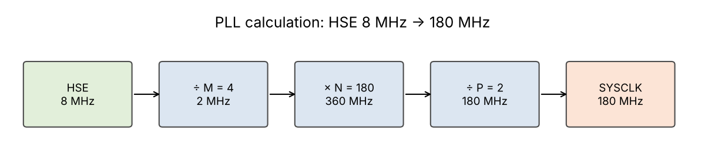
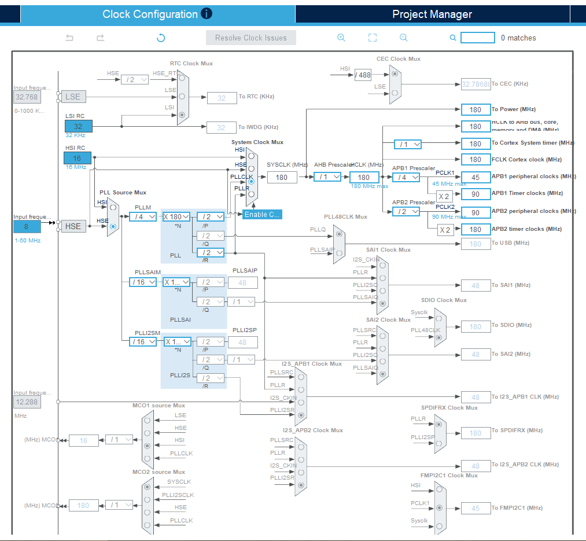
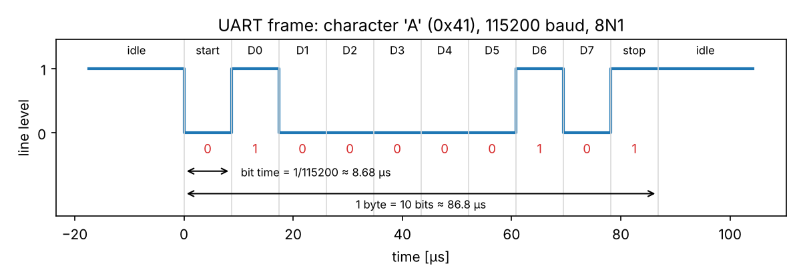
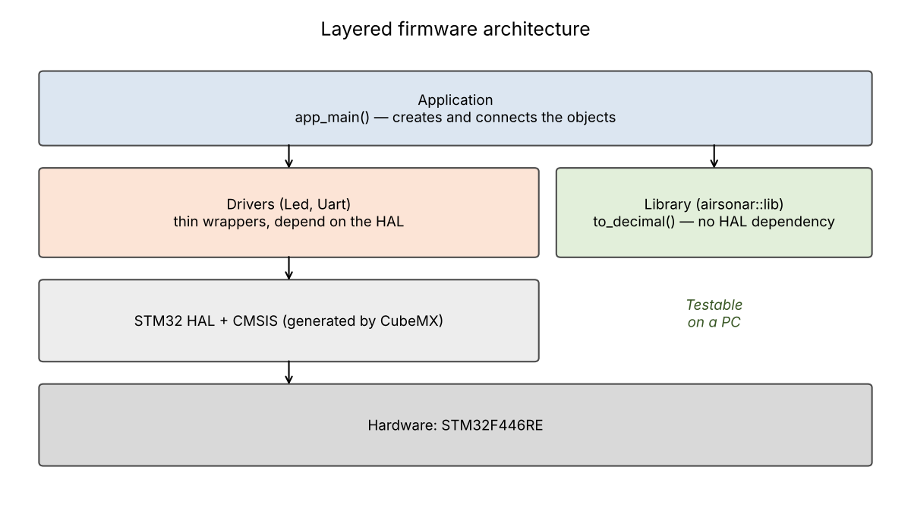
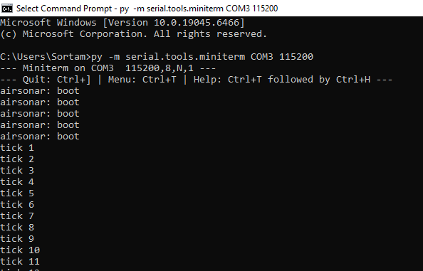

# Week 01: First C++ Firmware

*An LED and UART application on the STM32F446RE following the AUTOSAR C++14 guidelines*

**Author:** Burak  
**Date:** 16 November 2026  
**Status:** Completed  
**Code:** `firmware/nucleo-f446re/airsonar-fw/`  
**Compliance log:** `docs/coding-rules/compliance-log.md` (CR-001 … CR-032)  
**Language:** English (a Turkish version is available as a separate file)  

## Scope of this report

This report documents the first firmware work of the airsonar project. A project was created for the NUCLEO-F446RE board, an application layer written in C++ was set up, the on-board LED was toggled, and text was sent to a PC over UART. All application code was written and reviewed against the AUTOSAR C++14 coding guidelines.

The report is organized as follows:

- **Sections 1–2:** Objectives, hardware and tools.
- **Section 3:** Background: microcontroller structure, clock tree, UART, combining C and C++, layered architecture.
- **Section 4:** Step-by-step description of the implementation.
- **Section 5:** Side-by-side comparison of common code and AUTOSAR C++14 compliant code.
- **Sections 6–10:** Results, problems encountered, lessons learned, next steps and glossary.

## 1. Objectives

The purpose of this work is to build the firmware foundation on which the data acquisition and signal processing work of the coming weeks will rest. The following objectives were set:

1. Configure the board's clocks, pins and peripherals with STM32CubeMX.
2. Bridge the C code generated by CubeMX and the project's own C++ code.
3. Tighten the compiler settings to support the AUTOSAR C++14 guidelines and prove that they work.
4. Toggle the LED at a fixed interval.
5. Send text and numbers over UART without using `printf`.
6. Write the first hardware-independent library function that can be tested on a PC.

## 2. Hardware and development environment

**Table 1. Main features of the NUCLEO-F446RE board**

| Feature | Value |
|---|---|
| Microcontroller | STM32F446RE, ARM Cortex-M4F |
| Maximum clock frequency | 180 MHz |
| Flash memory | 512 KB |
| SRAM | 128 KB |
| Floating-point unit | Single-precision hardware FPU |
| Programmer and debugger | On-board ST-LINK; also provides a virtual COM port over USB |
| User LED (LD2) | PA5 |
| User button (B1) | PC13 |
| UART connected to the PC | USART2: PA2 (TX), PA3 (RX) |

**Table 2. Software tools**

| Tool | Purpose |
|---|---|
| STM32CubeMX | Pin, clock and peripheral configuration; generation of start-up code |
| STM32CubeIDE (2.x) | Editing, building, flashing and debugging |
| STM32Cube FW_F4 V1.28.3 | HAL library and CMSIS files |
| ST-LINK GDB server 7.14.0, STM32CubeProgrammer 2.23.0 | Flashing and debug connection |
| Python pyserial (miniterm) | Serial terminal on the PC |
| AUTOSAR C++14 Guidelines, Release 17-10 | Coding rules |

> **Note:** in STM32CubeIDE 2.x, CubeMX is no longer integrated into the IDE. The project was created in the standalone STM32CubeMX application and then imported into CubeIDE. The CubeMX2 tool was not used, because it currently supports only the newest STM32 series.

## 3. Background

### 3.1 Structure of a microcontroller

In a desktop computer the processor, memory and peripherals are separate components running an operating system. In a microcontroller they are all inside a single chip and there is no operating system. When the board is powered, the processor starts executing the program stored in Flash memory directly.

Hardware is controlled by reading and writing specific memory addresses. Each peripheral has control fields called **registers**, located at fixed addresses:

**Table 3. Main regions of the STM32F446RE memory map**

| Address | Region |
|---|---|
| `0x0800 0000` | Flash memory: program code and constants |
| `0x2000 0000` | SRAM: variables and stack |
| `0x4000 0000` and above | Peripheral registers (e.g. USART2: `0x4000 4400`, GPIOA: `0x4002 0000`) |

Turning on the LED, for example, means setting bit 5 of GPIOA's output register. The HAL library hides these operations behind functions.

### 3.2 Clock tree

Every unit in the microcontroller runs from a clock signal. The STM32F446RE has two main clock sources:

- **HSI:** a 16 MHz RC oscillator inside the chip. It needs no external parts, but its accuracy is around ±1 %.
- **HSE:** an external clock signal. On the NUCLEO-F446RE it comes from the crystal-controlled 8 MHz output of the on-board ST-LINK (bypass mode).

HSE was chosen for this project. The reason is directly linked to the project's purpose: in sonar measurements, range is computed from the sample rate. A 1 % error in the sample rate causes a 1 % error in the measured range.

The PLL (Phase-Locked Loop) divides and multiplies the input frequency to produce a high system frequency:



*Figure 1. PLL calculation from the HSE input to the 180 MHz system clock.*

```
f_SYSCLK = f_HSE / M × N / P = 8 MHz / 4 × 180 / 2 = 180 MHz
```

Peripherals are connected to two buses depending on their speed. APB1, which serves slower peripherals, runs at up to 45 MHz; APB2, which serves faster ones, at up to 90 MHz. Running at 180 MHz also requires the voltage regulator in its highest mode (Scale 1, Over-Drive) and 5 wait states (5 WS) for Flash access.

**Table 4. Resulting clock values**

| Signal | Frequency | Limit |
|---|---|---|
| SYSCLK / HCLK | 180 MHz | 180 MHz |
| APB1 peripherals | 45 MHz | 45 MHz |
| APB1 timers | 90 MHz | — |
| APB2 peripherals | 90 MHz | 90 MHz |
| APB2 timers | 180 MHz | — |

> **The ×2 rule for timers:** if an APB prescaler is not 1, the timers on that bus run at twice the bus frequency. APB1 runs at 45 MHz, but APB1 timers run at 90 MHz. In Week 3 a 48 kHz sample rate will be generated with an APB1 timer: 90 000 000 / 48 000 = 1875, an integer divider, so the sample rate can be produced without error.



*Figure 2. CubeMX Clock Configuration: 180 MHz system clock from the HSE (8 MHz) source.*

### 3.3 UART

UART (Universal Asynchronous Receiver-Transmitter) lets two devices communicate over two wires: one for transmitting (TX) and one for receiving (RX). There is no shared clock, so both sides must agree on the speed (**baud rate**) in advance. This work uses **115200 baud, 8N1** (8 data bits, no parity, 1 stop bit).

The idle line is at logic 1. Each byte starts with a start bit (0), continues with 8 data bits, least significant bit first, and ends with a stop bit (1). Each byte therefore occupies 10 bits on the line.



*Figure 3. The character 'A' (0x41) on the line at 115200 baud, 8N1.*

**Table 5. Timing at 115200 baud**

| Quantity | Value |
|---|---|
| One bit | 1 / 115 200 ≈ 8.68 µs |
| One byte (10 bits) | ≈ 86.8 µs |
| Maximum data rate | 11 520 bytes/s |

On the NUCLEO board, the USART2 pins are wired to the ST-LINK, which presents the data to the PC as a virtual COM port over USB. No extra cable is required.

### 3.4 Combining C and C++

CubeMX generates only C code, while the project's own code is written in C++. To support function overloading, the C++ compiler changes function names according to their parameter types (**name mangling**); the C compiler does not. A C++ function that is called from a C file must therefore be declared `extern "C"`, so that it is compiled with a name C understands.

In this project the only crossing point between C and C++ is `app_main()`. The CubeMX-generated `main.c` calls it after initializing the hardware; from then on the program runs entirely on the C++ side.

### 3.5 Layered architecture

Part of any firmware must touch the hardware. Keeping that part small and in one layer makes the rest of the code hardware-independent. The code in this work is split into three layers:



*Figure 4. Layered structure of the firmware.*

- **Application (`app_main`):** creates the objects and connects them. It is the only place that knows which pin and which UART are used.
- **Drivers (`Led`, `Uart`):** thin classes that wrap HAL functions. Only this layer touches the hardware.
- **Library (`airsonar::lib`):** code with no dependency on the HAL. It can be built and tested on a PC and later reused in the Qt application.

Driver classes do not choose their hardware themselves; it is passed in from outside (`Uart uart{huart2};`). This technique is called **dependency injection**. The same idea is implemented as the Microcontroller Abstraction Layer (MCAL) in the AUTOSAR Classic Platform architecture.

## 4. Implementation

### 4.1 CubeMX configuration

**Table 6. Pin configuration**

| Pin | Function | Label | Description |
|---|---|---|---|
| PA5 | GPIO_Output | LD2 | Green user LED |
| PC13 | GPIO_EXTI13 | B1 | Blue user button, interrupt input (Week 2) |
| PA2 / PA3 | USART2 TX / RX | — | ST-LINK virtual COM port |
| PH0 / PH1 | RCC_OSC_IN / OUT | — | HSE input (bypass) |
| PA13 / PA14 | SWDIO / SWCLK | — | Debug connection |

By default CubeMX assigned the LED and button to the board support package (**BSP**). The button being managed by both the BSP and the project caused a build error (Section 7). Since the project uses the LED and button directly as GPIO, the BSP was disabled. SPI2 was chosen for future SPI work, because the SPI1 clock pin conflicts with PA5.

### 4.2 Project structure and code ownership

**Table 7. Folder structure**

| Folder | Owner | Content |
|---|---|---|
| `Core/`, `Drivers/` | CubeMX | Generated start-up code, HAL and CMSIS |
| `App/Inc`, `App/Src` | Project | `app.h`, `app.hpp`, `app.cpp`: application and drivers |
| `App/Lib/Inc`, `App/Lib/Src` | Project | `text_format.hpp/.cpp`: hardware-independent library |

Every time CubeMX regenerates code it updates `Core/` and `Drivers/` and only preserves lines between `USER CODE BEGIN` and `USER CODE END`. Only two lines were therefore added to `main.c`: `#include "app.h"` and `app_main();`. All other project code is in `App/`.

### 4.3 Compiler settings

The settings below apply only to the C++ compiler (G++). Because the only C++ code is in `App/`, the C code generated by CubeMX is not affected.

**Table 8. C++ compiler settings**

| Setting | Purpose |
|---|---|
| `-std=c++17` | Standard C++17 without GNU extensions |
| `-fno-exceptions`, `-fno-rtti` | Exceptions and run-time type information disabled (CubeIDE adds these to C++ projects by default) |
| `-fno-threadsafe-statics` | No unnecessary locking code for local static variables |
| `-Wall -Wextra -pedantic` | Broad warnings and warnings for non-standard code |
| `-Wconversion -Wsign-conversion` | Catch implicit type and sign conversions. In C++, `-Wconversion` does not cover sign conversions, so the second flag is added explicitly. |
| `-Wshadow` | Catch a name hiding another name in an outer scope |
| `-Werror` | Treat all warnings as errors |

A deliberate error was added to the code to prove that these settings work (Section 6.2).

### 4.4 C/C++ bridge

Two separate headers are used for `app_main()`: `app.h` is included by `main.c`, compiled as C; `app.hpp` is included by the C++ side. Section 5.2 explains why the common single-header approach was not used.

```cpp
// App/Inc/app.h — C interface
#ifndef AIRSONAR_APP_H
#define AIRSONAR_APP_H
/* C++ declaration: app.hpp. Keep both in sync (CR-014). */
void app_main(void);
#endif

// App/Inc/app.hpp — C++ declaration
#ifndef AIRSONAR_APP_HPP
#define AIRSONAR_APP_HPP
// C declaration: app.h. Keep both in sync (CR-014).
extern "C" void app_main() noexcept;
#endif
```

### 4.5 Drivers: Led and Uart

```cpp
class Led final {
public:
    Led(GPIO_TypeDef* const port, std::uint16_t const pin) noexcept : port_{port}, pin_{pin} {}
    void toggle() noexcept { HAL_GPIO_TogglePin(port_, pin_); }
private:
    GPIO_TypeDef* const port_;
    std::uint16_t const pin_;
};

class Uart final {
public:
    explicit Uart(UART_HandleTypeDef& handle) noexcept : handle_{handle} {}

    template <std::size_t N>
    bool write(std::array<std::uint8_t, N> const& data, std::size_t const length) noexcept
    {
        static_assert(N <= kMaxFrameSize, "HAL_UART_Transmit takes at most 65535 bytes");
        bool sent{false};
        if (length <= N) {
            HAL_StatusTypeDef const status{HAL_UART_Transmit(
                &handle_, data.data(), static_cast<std::uint16_t>(length), kTimeoutMs)};
            sent = (status == HAL_OK);
        }
        return sent;
    }

    template <std::size_t N>
    bool write(std::array<std::uint8_t, N> const& data) noexcept { return write(data, N); }

private:
    static constexpr std::size_t kMaxFrameSize{65535U};
    static constexpr std::uint32_t kTimeoutMs{100U};
    UART_HandleTypeDef& handle_;
};
```

Constant text is converted to byte arrays at compile time by `to_bytes()`:

```cpp
template <std::size_t N>
constexpr std::array<std::uint8_t, N - 1U> to_bytes(char const (&text)[N]) noexcept
{
    static_assert(N > 1U, "Text must not be empty");
    std::array<std::uint8_t, N - 1U> bytes{};
    for (std::size_t i{0U}; i < (N - 1U); ++i) {
        bytes[i] = static_cast<std::uint8_t>(text[i]);
    }
    return bytes;
}
```

### 4.6 Library: to_decimal()

Because `printf` is not used, a separate function converts numbers to text. The algorithm relies on the fact that the remainder of a division by 10 is the last digit and the quotient holds the remaining digits. This produces the digits in reverse order, so they are first collected in a temporary array and then copied in the correct order.

**Table 9. Converting the number 472**

| Step | remaining | remaining % 10 | remaining / 10 | Temporary array |
|---|---|---|---|---|
| 1 | 472 | 2 | 47 | '2' |
| 2 | 47 | 7 | 4 | '2' '7' |
| 3 | 4 | 4 | 0 | '2' '7' '4' |
| Copy | — | — | — | Output: '4' '7' '2' |

```cpp
std::size_t to_decimal(std::uint32_t value,
                       std::array<std::uint8_t, kMaxDecimalDigits>& digits) noexcept
{
    std::array<std::uint8_t, kMaxDecimalDigits> reversed{};
    std::size_t count{0U};
    std::uint32_t remaining{value};

    while ((remaining > 0U) || (count == 0U)) {
        std::uint32_t const digit{remaining % kDecimalBase};
        reversed[count] = static_cast<std::uint8_t>(kAsciiZero + digit);
        ++count;
        remaining = remaining / kDecimalBase;
    }
    for (std::size_t i{0U}; i < count; ++i) {
        digits[i] = reversed[count - 1U - i];
    }
    return count;
}
```

### 4.7 Main loop

```cpp
extern "C" void app_main() noexcept
{
    constexpr std::uint32_t kLedToggleIntervalMs{500U};
    constexpr auto kBootMessage{to_bytes("airsonar: boot\r\n")};
    constexpr auto kTickPrefix{to_bytes("tick ")};
    constexpr auto kLineEnd{to_bytes("\r\n")};

    Led led{LD2_GPIO_Port, LD2_Pin};
    Uart uart{huart2};
    std::uint32_t tick_count{0U};
    std::array<std::uint8_t, airsonar::lib::kMaxDecimalDigits> digits{};

    static_cast<void>(uart.write(kBootMessage));
    while (true) {
        led.toggle();
        tick_count = next_count(tick_count);
        std::size_t const length{airsonar::lib::to_decimal(tick_count, digits)};
        static_cast<void>(uart.write(kTickPrefix));
        static_cast<void>(uart.write(digits, length));
        static_cast<void>(uart.write(kLineEnd));
        HAL_Delay(kLedToggleIntervalMs);
    }
}
```

The LED changes state every 500 ms, so one full blink takes 1 second: the blink frequency is **1 Hz**.

## 5. Common code versus AUTOSAR C++14 compliant code

This section compares, part by part, code forms that are common in embedded software examples with the AUTOSAR C++14 compliant forms used in this project. Each comparison lists the rule, the risk of the common form, the benefit of the compliant form and its cost. The detailed rationale for each rule is in the compliance log.

### 5.1 Header guard

**Common form**

```cpp
#pragma once
```

**AUTOSAR C++14 compliant form**

```cpp
#ifndef AIRSONAR_APP_HPP
#define AIRSONAR_APP_HPP
// ...
#endif  // AIRSONAR_APP_HPP
```

**Table 10. Assessment**

| Aspect | Details |
|---|---|
| **Rule** | A16-7-1: The `#pragma` directive shall not be used. M16-2-3: Include guards shall be provided. |
| **Risk of the common form** | `#pragma once` is not part of the C++ standard; its behaviour depends on the compiler. |
| **Benefit of the compliant form** | A standard method that behaves the same with every compiler. |
| **Cost** | Three lines instead of one; guard names must be kept unique. |

### 5.2 C/C++ bridge

**Common form**

```cpp
#ifdef __cplusplus
extern "C" {
#endif
void app_main(void);
#ifdef __cplusplus
}
#endif
```

**AUTOSAR C++14 compliant form**

```cpp
// app.h (C)
void app_main(void);

// app.hpp (C++)
extern "C" void app_main() noexcept;
```

**Table 11. Assessment**

| Aspect | Details |
|---|---|
| **Rule** | A16-0-1: The pre-processor shall only be used for file inclusion and include guards. |
| **Risk of the common form** | Conditional compilation is used for a declaration; the same file produces different content depending on the compiler. |
| **Benefit of the compliant form** | Pre-processor use stays limited to include guards. The C++ declaration can carry `noexcept`, which is not valid C. |
| **Cost** | The function has two declarations that must be kept in sync by hand (CR-014). |

### 5.3 Delay value

**Common form**

```cpp
HAL_Delay(500);
```

**AUTOSAR C++14 compliant form**

```cpp
constexpr std::uint32_t kLedToggleIntervalMs{500U};
HAL_Delay(kLedToggleIntervalMs);
```

**Table 12. Assessment**

| Aspect | Details |
|---|---|
| **Rule** | A5-1-1: Symbolic names shall be used instead of literal values. A7-1-2: Values known at compile time shall be `constexpr`. M5-0-4: Implicit conversions shall not change signedness. M3-4-1: An identifier's visibility shall be minimized. |
| **Risk of the common form** | The meaning and unit of `500` cannot be read from the code. A signed `int` literal is implicitly converted to an unsigned parameter. |
| **Benefit of the compliant form** | The name states the meaning and unit (ms). `500U` is unsigned, so no conversion happens. The constant is defined only inside the function that uses it. |
| **Cost** | One extra line. |

### 5.4 LED class

**Common form**

```cpp
class Led {
public:
    Led(GPIO_TypeDef* port, uint16_t pin) : port_(port), pin_(pin) {}
    void toggle() { HAL_GPIO_TogglePin(port_, pin_); }
private:
    GPIO_TypeDef* port_;
    uint16_t pin_;
};
```

**AUTOSAR C++14 compliant form**

```cpp
class Led final {
public:
    Led(GPIO_TypeDef* const port, std::uint16_t const pin) noexcept : port_{port}, pin_{pin} {}
    void toggle() noexcept { HAL_GPIO_TogglePin(port_, pin_); }
private:
    GPIO_TypeDef* const port_;
    std::uint16_t const pin_;
};
```

**Table 13. Assessment**

| Aspect | Details |
|---|---|
| **Rule** | A7-1-1: Immutable data shall be `const`. A12-4-2 (advisory): A class with a non-virtual public destructor should be `final`. A15-4-4: Non-throwing functions shall be `noexcept`. A8-5-2: Brace initialization shall be used. A3-9-1: Fixed-width integer types shall be used. |
| **Risk of the common form** | Port and pin can be changed by mistake during the object's life. Deriving from the class and deleting through a base pointer is undefined behaviour. |
| **Benefit of the compliant form** | The compiler enforces immutability; inheritance is prevented; narrowing conversions are rejected at compile time. |
| **Cost** | Objects cannot be copy-assigned. Conflicts with clang-tidy's C++ Core Guidelines C.12 check; the conflict is recorded (CR-024). |

### 5.5 Sending text

**Common form**

```cpp
printf("tick %lu\r\n", tick_count);
```

**AUTOSAR C++14 compliant form**

```cpp
std::size_t const length{airsonar::lib::to_decimal(tick_count, digits)};
static_cast<void>(uart.write(kTickPrefix));
static_cast<void>(uart.write(digits, length));
static_cast<void>(uart.write(kLineEnd));
```

**Table 14. Assessment**

| Aspect | Details |
|---|---|
| **Rule** | M27-0-1: The stream input/output library `<cstdio>` shall not be used. |
| **Risk of the common form** | A mismatch between the format string and the argument type is undefined behaviour. On a microcontroller `printf` pulls in a large formatting library and often dynamic memory. |
| **Benefit of the compliant form** | All types are checked at compile time. Constant text is converted to bytes at compile time. Number conversion happens in a hardware-independent function that can be tested on a PC. |
| **Cost** | More lines of code; the formatting function must be written and tested separately. |

### 5.6 Converting text to bytes

**Common form**

```cpp
HAL_UART_Transmit(&huart2, (uint8_t*)"tick\r\n", 6, HAL_MAX_DELAY);
```

**AUTOSAR C++14 compliant form**

```cpp
constexpr auto kTickMessage{to_bytes("tick\r\n")};
static_cast<void>(uart.write(kTickMessage));
```

**Table 15. Assessment**

| Aspect | Details |
|---|---|
| **Rule** | A5-2-2: C-style casts shall not be used. A5-2-3: A cast shall not remove `const`. A5-2-4: `reinterpret_cast` shall not be used. |
| **Risk of the common form** | The cast removes `const` and bypasses the type system. The length (6) is written by hand; if the text changes and the length does not, too few or too many bytes are sent. |
| **Benefit of the compliant form** | No pointer is cast. The compiler computes the length. The conversion happens at compile time, so it has no run-time cost. |
| **Cost** | The `to_bytes()` parameter is a reference to a C-style array; this is recorded as a deviation from advisory rule A18-1-1 (D-004). |

### 5.7 Length and array bounds

**Common form**

```cpp
HAL_UART_Transmit(&huart2, buffer, strlen((char*)buffer), HAL_MAX_DELAY);
```

**AUTOSAR C++14 compliant form**

```cpp
static_assert(N <= kMaxFrameSize, "HAL_UART_Transmit takes at most 65535 bytes");
if (length <= N) {
    HAL_StatusTypeDef const status{HAL_UART_Transmit(
        &handle_, data.data(), static_cast<std::uint16_t>(length), kTimeoutMs)};
    sent = (status == HAL_OK);
}
```

**Table 16. Assessment**

| Aspect | Details |
|---|---|
| **Rule** | A4-7-1: An integer expression shall not lead to data loss. A5-2-5: An array shall not be accessed beyond its range. |
| **Risk of the common form** | `strlen` reads past the end of a buffer that is not zero-terminated. The `size_t` length is implicitly narrowed to the `uint16_t` parameter. With `HAL_MAX_DELAY` the program waits forever on an error. |
| **Benefit of the compliant form** | It is proven at compile time that the length fits in `uint16_t`; a length beyond the array size is rejected; the timeout is bounded (100 ms). |
| **Cost** | The function is a template; the array size is part of the type. |

### 5.8 Function return value

**Common form**

```cpp
uart.write(kTickMessage);
```

**AUTOSAR C++14 compliant form**

```cpp
// Diagnostic output only: a failed transmission must not stop the firmware.
static_cast<void>(uart.write(kTickMessage));
```

**Table 17. Assessment**

| Aspect | Details |
|---|---|
| **Rule** | A0-1-2: The return value of a non-void function shall be used; it may be discarded explicitly with `static_cast<void>`. |
| **Risk of the common form** | Error information is lost silently; a reader cannot tell whether ignoring it was intentional. |
| **Benefit of the compliant form** | The decision itself becomes visible in the code. Here the output is diagnostic only, so a failed transmission must not stop the firmware. |
| **Cost** | A cast and an explanatory comment at each call. |

### 5.9 A loop that also handles zero

**Common form**

```cpp
do {
    reversed[count++] = '0' + (value % 10);
    value /= 10;
} while (value > 0);
```

**AUTOSAR C++14 compliant form**

```cpp
while ((remaining > 0U) || (count == 0U)) {
    std::uint32_t const digit{remaining % kDecimalBase};
    reversed[count] = static_cast<std::uint8_t>(kAsciiZero + digit);
    ++count;
    remaining = remaining / kDecimalBase;
}
```

**Table 18. Assessment**

| Aspect | Details |
|---|---|
| **Rule** | A6-5-3 (advisory): `do` statements should not be used. A4-7-1, M5-0-4: Implicit conversions and data loss. |
| **Risk of the common form** | The exit condition is at the bottom, which is harder to read. `'0' + (value % 10)` is narrowed implicitly. `count++` is a side effect inside an expression. |
| **Benefit of the compliant form** | The condition is visible at the top; for 0 the loop still runs at least once. Every conversion is explicit. |
| **Cost** | The condition is slightly more complex; the purpose of `count == 0U` needs explaining. |

### 5.10 Counter

**Common form**

```cpp
tick_count++;
```

**AUTOSAR C++14 compliant form**

```cpp
std::uint32_t next_count(std::uint32_t const count) noexcept
{
    std::uint32_t next{0U};
    if (count < std::numeric_limits<std::uint32_t>::max()) {
        next = count + 1U;
    }
    return next;
}
```

**Table 19. Assessment**

| Aspect | Details |
|---|---|
| **Rule** | A4-7-1: An integer expression shall not lead to data loss; the rule explicitly includes wrap-around. |
| **Risk of the common form** | The counter silently wraps to 0 after 4 294 967 295. This behaviour is not visible in the code. |
| **Benefit of the compliant form** | The wrap is explicit and intentional. At 500 ms per tick it happens after about 68 years, but the behaviour is documented. |
| **Cost** | A small function instead of a single increment. |

### 5.11 Where the function lives

**Common form**

```cpp
std::size_t to_decimal(std::uint32_t value, ...);   // global namespace
```

**AUTOSAR C++14 compliant form**

```cpp
namespace airsonar {
namespace lib {
std::size_t to_decimal(std::uint32_t value, ...) noexcept;
}  // namespace lib
}  // namespace airsonar
```

**Table 20. Assessment**

| Aspect | Details |
|---|---|
| **Rule** | M7-3-1: The global namespace shall only contain `main`, namespace declarations and `extern "C"` declarations. |
| **Risk of the common form** | A name collision with a function of the same name in another library, including the HAL's C functions. |
| **Benefit of the compliant form** | Name collisions are avoided; the `airsonar::lib::` prefix shows which layer the code comes from. |
| **Cost** | Longer function calls. |

## 6. Results

### 6.1 The working system

On power-up the board sends `airsonar: boot`; the LED then changes state every 500 ms and an increasing counter is sent to the PC over UART.



*Figure 5. Terminal output: boot message and increasing tick counter (COM3, 115200 baud, 8N1).*

**Table 21. Evolution of the program size**

| Stage | Flashed size | Description |
|---|---|---|
| Empty CubeMX project | 8.63 KB | HAL start-up code, clock and peripheral configuration |
| LED | 8.88 KB | `Led` class, `HAL_GPIO_TogglePin`, `HAL_Delay` |
| UART and counter | 10.46 KB | `Uart` class, HAL UART driver, `to_decimal()` |

The program uses about 2 % of the 512 KB Flash memory.

### 6.2 Verifying the compiler settings

A build without warnings can mean either that the code is clean or that the warnings do not work. To find out which, a line passing a signed value to an unsigned parameter was added on purpose:

```cpp
std::int32_t const test_value{-1};
HAL_Delay(test_value);
```

The compiler rejected it:

```cpp
error: unsigned conversion from 'int32_t' {aka 'long int'} to 'uint32_t'
{aka 'long unsigned int'} changes value from '-1' to '4294967295' [-Werror=sign-conversion]
```

Had this not been caught, `HAL_Delay` would have waited 4 294 967 295 ms, about **49.7 days**, and the board would have looked frozen. The test lines were removed after the check.

### 6.3 to_decimal() tests

**Table 22. Boundary tests (on a PC, with strict compiler settings)**

| Input | Expected | Result |
|---|---|---|
| 0 | "0" | Pass |
| 7 | "7" | Pass |
| 10 | "10" | Pass |
| 42 | "42" | Pass |
| 472 | "472" | Pass |
| 1000 | "1000" | Pass |
| 4 294 967 295 | "4294967295" | Pass |

During development the reversal index `count - 1U - 1` was tried instead of `count - 1U - i`. For multi-digit numbers this repeated the same digit (472 → "777"). For one-digit numbers the expression evaluated to `SIZE_MAX` in unsigned arithmetic, the code read memory outside the array and produced random characters (`"O"`, `"U"`). This is a concrete example of the out-of-bounds access targeted by A5-2-5, and it shows that such a defect appears only for specific inputs.

## 7. Problems and fixes

**Table 23. Problems**

| Problem | Root cause | Fix |
|---|---|---|
| Project could not be created from a board in CubeIDE | CubeMX is not integrated in CubeIDE 2.x | Project created in standalone CubeMX and imported |
| `H_EXTI_13` undeclared | The button was configured both as BSP and as GPIO | BSP (Human Machine Interface) disabled |
| The `led` project was built instead | The hammer icon builds the project selected in Project Explorer | The correct project was selected and built |
| Program size unchanged, LED not blinking | The `USER CODE` blocks in `main.c` were empty; the linker removed the unused `app_main` | `#include` and `app_main()` call added |
| `app.h` not found | Missing include path | `../App/Inc` added for GCC and G++ |
| Files created under `Core/` | Folder ownership rule not yet known | Files moved to the `App/` source folder |
| Expected warnings from HAL headers did not appear | CMSIS disables these warnings for its own code with `#pragma GCC diagnostic` | A deliberate error proved that the settings work |
| Only the boot message appeared | `++count` missing in `to_decimal()`; the loop never ended | Missing line added |
| Tests did not catch the defect | Tests ran on a corrected copy instead of the developer's file | Tests will run directly on the repository files (Week 3) |

## 8. Lessons learned

- The choice of clock source directly affects measurement accuracy; HSE should be used for the sonar application.
- Timer clocks can be twice the bus clock, depending on the APB prescaler.
- C and C++ code can work together through a single crossing point (`extern "C"`).
- Keeping generated code and project code in separate folders prevents code generators from overwriting project code.
- A build without warnings is not proof on its own; the safety net must be tested with a deliberate error.
- "It compiles" is not "it works"; only tests catch logic errors, and they must run on the actual code.
- Coding standards can contradict each other (AUTOSAR A7-1-1 versus C++ Core Guidelines C.12); one baseline must be chosen and conflicts recorded.
- Concentrating hardware-dependent code in a thin layer allows the rest of the code to be tested on a PC.

## 9. Next steps

- Move the `Led` and `Uart` classes to `App/Drivers/` to complete the layered structure.
- Control GPIO at register level and compare with the HAL.
- Read the user button with an interrupt; share data between the interrupt and the main loop.
- Set up a PC build for library tests (Week 3).

## 10. Glossary

**Table 24. Terms used in this report**

| Term | Short explanation |
|---|---|
| Register | A control field of a peripheral at a specific memory address. |
| HAL | Hardware Abstraction Layer; ST's library for using peripherals through functions. |
| CMSIS | ARM's standard headers and functions for Cortex-M processors. |
| BSP | Board Support Package; ready-made drivers for a specific board's LEDs, buttons, etc. |
| HSI / HSE | Internal / external high-speed clock source. |
| PLL | A circuit that divides and multiplies an input frequency to produce a high-frequency clock. |
| APB1 / APB2 | Peripheral buses with different maximum speeds. |
| Flash wait states (WS) | Extra cycles added to Flash access at high clock frequencies. |
| UART, baud rate, 8N1 | Asynchronous serial communication; speed in bit/s; 8 data bits, no parity, 1 stop bit. |
| Virtual COM port | The serial port through which the ST-LINK presents UART data to the PC over USB. |
| Name mangling | The C++ compiler changing function names according to their parameter types. |
| `extern "C"` | A specifier that makes a C++ function compile with a C-compatible name. |
| Include guard | A construct that prevents a header from being included more than once in a translation unit. |
| Dependency injection | Passing the resources an object uses to it from outside. |
| Deviation | A deliberate, documented departure from a coding rule. |
| Wrap-around | An unsigned number returning to zero after exceeding its maximum value. |
| Out-of-bounds access | Reading or writing a memory location outside an array. |

## References

- STMicroelectronics, *RM0390 Reference Manual: STM32F446xx advanced Arm-based 32-bit MCUs*.
- STMicroelectronics, *UM1724 User Manual: STM32 Nucleo-64 boards (MB1136)*.
- STMicroelectronics, *UM1725 Description of STM32F4 HAL and low-layer drivers*.
- AUTOSAR, *Guidelines for the use of the C++14 language in critical and safety-related systems*, Release 17-10.
- Project documents: `CODING_STANDARD.md`, `docs/coding-rules/compliance-log.md`.
